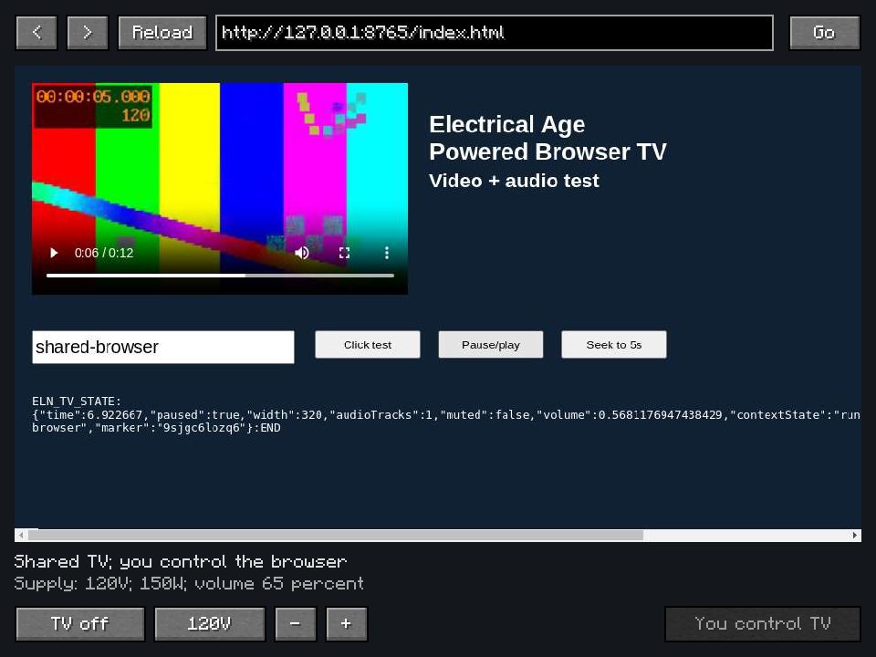

# EA Media 1.0.3: Shared browser televisions

A placed TV now elects one nearby client to host Chromium. Other viewers receive its rendered
picture and captured audio through the server, rather than opening independent webpage sessions.
The TV screen and browser controls use that same stream. One player controls the page at a time;
another player can watch or request control. Browser hosting and interactive control are separate.

Input packets carry the controller validated by the server. Changing controllers releases held
inputs, and delayed display metadata cannot blur the browser immediately after a new controller's
click. Browser and control heartbeats use elapsed time, so low client FPS does not turn frame
counts into expired leases. Mouse, keyboard and clipboard input remain bounded and validated.

Streams are bounded to JPEG frames up to 960×540 at 12 fps and stereo 24 kHz PCM. Fragments fit
Minecraft's serverbound payload limit; old, duplicate, incomplete, oversized and stale-session
frames are rejected. Only a nearby active host may publish. Viewers maintain bounded decode/audio
queues, and server-side caches are cleared when unused or unpowered. The server never runs a
browser or decodes media. This is compressed screen sharing, not lossless frame synchronization.

If the host leaves, another nearby viewer opens the shared URL and attempts to resume ordinary
media. Browser cookies, logins and arbitrary form state do not migrate. Protected media or sites
that prevent audio capture may not provide mirrored sound. See the
[TV guide](powered-browser-tv.md#shared-screen-103) for behavior and bandwidth limits.

## Build and unit checks

The full ordinary build and translation generation pass **28 tests in 7 suites**, with no failures,
errors or skips. These include host/controller leases, saved playback, power-aware clocks, bounded
input, controller-stamped packet codecs, frame reassembly, JPEG validation and audio buffering.
The final build also uses the declared ELN 3.0.60 minimum; native checks use ELN 3.0.63.
[Unit evidence](verification/release-1.0.3/units.json) and
[package checks](verification/release-1.0.3/packaging.json) include both jar variants.

The full client jar retains all four verified Chromium platform bundles and the existing jukebox
tools. The small server jar excludes their native archives. Device IDs, baked cabinets, recipes,
power ratings and jukebox behavior remain unchanged. All clients and the server must update the
addon together because the shared-TV protocol is required.

## Native multiplayer checks

Two separate clients joined a localhost dedicated server with Sodium 0.8.13, Iris 1.8.14 beta,
BSL 10.1.8 and Distant Horizons 3.3.3. The host ran Chromium; the late viewer had no browser,
yet received video and 303,104 bytes of non-silent PCM in the first observation. Its typed
`shared-browser` text and button click reached the host's same page instance. Remote seek and
pause stopped it at 6.922667 seconds. After the controls settled, the viewer's JPEG hash matched
the server's cached host frame exactly (`-960438488`).

Disconnecting the host elected the remaining viewer, which opened a new page instance and
resumed the paused video. Setting the actual placed supply to 0 V closed the browser and cleared
the stream cache; restoring 120 V reopened it at the saved paused position. The page's empty
form after handoff confirms the documented reload limitation rather than pretending to transfer
arbitrary browser memory. OpenAL used its headless No Output device; PCM capture/transport and
stream setup were observed, not physical speaker output. No native FPS benchmark is claimed.

[Native observations](verification/release-1.0.3/native.json) record the individual checks.

Source-only prerelease. Attach your compiled `EAMedia-1.0.3.jar` and optional
`EAMedia-1.0.3-server.jar`. [Build instructions](building.md).
