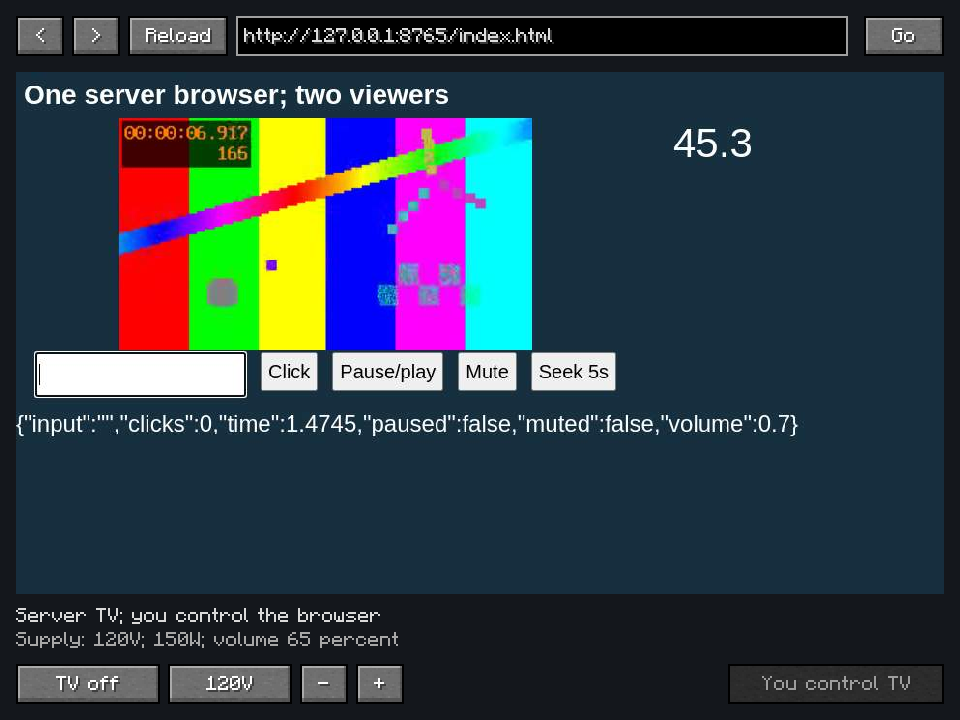

# EA Media 1.0.4: Server-hosted TV browser and shared audio

The reported 1.0.3 behavior had two different sound paths: the elected player's
browser played locally, while other viewers used relayed PCM. A stopped viewer
stream could retain its sound reference forever. A short buffer underrun could
also stop the OpenAL source: vanilla refilled it without restarting it.

The TV now runs one full Chromium browser in an isolated JVM owned by the server.
All players are viewers of that browser's JPEG/PCM stream, including the first
player to operate it. Control leases do not own hosting. Leaving, disconnecting
or changing controllers does not replace the server browser. A loaded, powered
TV retains its page/form state even while its viewer list is empty; forwarding
is suspended until someone returns. No chunk is force-loaded by this feature.

## Implementation

The main server thread validates player controls and relays bounded encoded
packets. Extraction, hashing, browser rendering, JPEG encoding, process startup,
socket reads/writes and process shutdown waits run elsewhere. A configurable
server-wide browser limit defaults to two. Moving browsers onto the server
consumes its CPU, native memory and outgoing bandwidth; process separation does
not make that work free or guarantee tick-time headroom.

The worker receives its URL, resume state and one-use loopback authentication
token over stdin. Its network peer is an ephemeral IPv4 loopback listener, using
the same address family even when Minecraft sets `preferIPv6Addresses=system`.
Its generated standalone jars contain the generic CEF bridge and a small JNI
input-constant compatibility table. That table is confined to the worker jar;
it never shadows Minecraft's LWJGL classes or creates a client GLFW window on
the server. Chromium uses its already-bundled, verified native payload. Linux
servers use their system `tar` after complete archive verification because
Minecraft's dedicated-server classpath lacks the client's Commons Compress.
Each extracted native file/link is still verified before installation commits.

On headless Linux the addon starts Xvfb when no `DISPLAY` is supplied. An ALSA
null sink removes any physical speaker requirement. The pinned upstream native
audio callback remains disabled because it leaks packet allocations and returns
only one channel. Document capture preserves page mute/volume, retries ended
media tracks and mixes iframe PCM onto one bounded, paced stereo clock. It does
not multiply playback speed or IPC bandwidth when several sources produce audio.

Every viewer uses Minecraft's local audio controls. Queues are bounded, stopped
streams are recreated, and short OpenAL underruns resume the existing TV channel.
Explicit stop/mute remains distinct from underrun recovery. Power loss closes the
browser, clears the relay cache and stops viewer sound; recovery creates a fresh
host epoch and attempts ordinary media resume. Browser cookies live in the TV's
server profile. Reloading cannot preserve arbitrary JavaScript memory/forms.

The required payload version is 3. Clients cannot publish TV pictures, audio or
playback reports. All server and client installations must update together. Item
IDs, baked cabinets, recipes, electrical ratings and jukebox behavior are retained.
The full addon jar is required on a TV-hosting server; the small server variant
omits the Chromium payload and reports that it cannot host a TV.

## Verification

The final build passes **33 tests in 8 suites**, with no failures, errors or skips.
[Unit results](verification/release-1.0.4/units.json),
[native observations](verification/release-1.0.4/native.json) and
[packaging checks](verification/release-1.0.4/packaging.json) are retained.
The build uses the declared ELN 3.0.60 minimum; native runs use 3.0.63.
The two jar variants retain the existing native payloads, with no new Gradle dependency.

Native checks use a localhost dedicated server, two separate Minecraft clients
and a generated WebM/audio webpage. They check that both clients receive and
consume PCM without creating a TV browser; remote typing/clicks reach the one
server page; changing controller and disconnecting the first viewer leave its
worker PID/epoch intact; a forced 500 ms client stall recovers; and electrical
power loss/recovery stops then recreates picture/audio with a new epoch.

A separate continuity check moves the last viewer beyond 32 blocks while keeping
the test chunk loaded. The server browser keeps the same PID and typed form with
zero viewers, and picture/audio return when the player comes back. The final
mute check distinguishes actual underrun recovery from deliberate local stop,
then restores a functioning stream after the volume slider is raised again.
During mute, the final consumed-byte counter stays at 209,280; unmute creates a
new stream and consumes new samples. This check uses actual stream consumption,
not the sound manager's provisional activity flag.

OpenAL uses its headless No Output device. Non-silent capture, PCM transport,
Minecraft stream consumption and channel state are observed; physical speakers
are not measured. The final clients include Sodium 0.8.13, Iris 1.8.14 beta and
Distant Horizons 3.3.3. Client A uses BSL 10.1.8; B disables shaders for its final
functional audio checks. Native server rendering runs on Linux x64 using an
existing private virtual display. Automatic Xvfb startup and other operating
systems are not natively exercised here. Public YouTube/DRM compatibility is not
claimed by the local-page check. No FPS or MSPT benchmark is claimed.

[Ubuntu setup and TV behavior](powered-browser-tv.md) · [build instructions](building.md)

Source-only prerelease. Attach the compiled `EAMedia-1.0.4.jar`; TV-hosting servers
must use that full jar, not the optional jukebox-only `-server.jar` variant.

